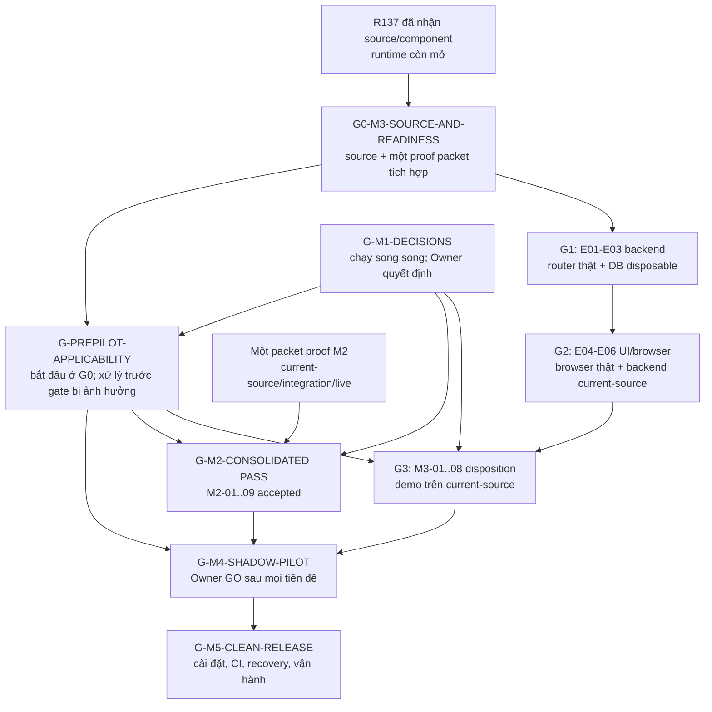

# Kế hoạch nghiệm thu sản phẩm CCMA: R137 đến M3, pilot và phát hành

Status: ACCEPTED_DOCUMENTARY_PLAN_ONLY
Risk: R1
Worker: Luna Max — IMPLEMENTATION_WORKER
Reviewer: Root — independent reviewer
Yêu cầu Owner: 2026-10-21, lộ trình mốc/evidence rõ ràng, không hứa ngày hoàn tất
Tài liệu chi tiết chuẩn: chính file này
Phạm vi sản phẩm: một installation, một use-case khiếu nại/khách chờ trên Pancake

## 1. Mục đích và giới hạn

Kế hoạch này chỉ định đường nghiệm thu hữu hạn, các quyết định đang thiếu, bằng chứng cần cho từng mốc và người có quyền chấp nhận. Đây là tài liệu planning; nó không nghiệm thu sản phẩm, cấp quyền chạy database/browser/provider, cấp grant, mở pilot, cho phép dùng dữ liệu khách hàng, hoặc cho phép phát hành. Các lần gọi provider, dữ liệu thật, pilot và deploy cần work order, seed, phạm vi tác động và ngân sách mới được owner chấp thuận.

Không hứa ngày hoàn tất và không suy ra phần trăm từ số tranche, lần chạy hay test. Từng mốc chỉ chuyển trạng thái khi đủ điều kiện và đúng tầng evidence. M1 quyết định nghiệp vụ có thể chạy song song với chuẩn bị M2/M3; M4 phải chờ cả M1, M2, M3 và các điều kiện an toàn. M5 chỉ mở sau quyết định GO của M4.

Phạm vi hiện hành là một bản cài cho một công ty hoặc cá nhân, với Pancake là kênh mục tiêu được roadmap nêu. Việc truy cập Pancake vẫn cần readiness và authority riêng. Facebook/Zalo OA và việc mở lại account, credentials, kết nối hoặc live test vẫn parked theo owner. Ngoài đường tới M3, kế hoạch không thêm auto-send cho khách, chạy đồng loạt nhiều kênh, mở rộng provider/model, tối ưu chi phí chưa có baseline, hay nâng CVF Core.

### Cách đọc trạng thái

| Trạng thái | Cách dùng |
|---|---|
| `ACCEPTED_BOUNDED` | Bằng chứng đã chấp nhận trong đúng source, fixture, hành động và giới hạn ghi kèm; không phải full-stage PASS. |
| `SOURCE_COMPONENT_ACCEPTED_RUNTIME_OPEN` | Source/component được review; route, DB, browser hoặc provider chưa có bằng chứng runtime tương ứng. |
| `HISTORICAL_EXACT_SOURCE_ONLY` | Receipt đúng tại revision/campaign đã ghi; không chuyển sang source mới và không mở lại ngân sách. |
| `OPEN` | Tiêu chí còn thiếu bằng chứng hoặc quyết định. Không tự suy thành PASS hay FAIL. |
| `HOLD` | Có prerequisite, thẩm quyền, resource, decision hoặc kết quả chưa xác định. Dừng phần phụ thuộc và giữ nguyên evidence. |
| `FAIL` | Một kiểm tra được chạy trong phạm vi đã duyệt quan sát kết quả trái acceptance. Giữ cả lần lỗi và sửa sau đó. |
| `N/A_WITH_REASON` | Chỉ dùng khi hợp đồng hiện hành loại trừ rõ tiêu chí và lưu lý do; phạm vi mới sẽ xét lại. |

`PASS` chỉ dành cho điều kiện được chứng minh ở tầng phù hợp trên source đã ghim. Mô hình UI không chứng minh quyền hoặc hành vi runtime; test local không chứng minh kênh/provider thật; hosted CI cũ không chứng minh revision mới. Bất kỳ claim nào rằng CVF kiểm soát AI ở runtime cần provider API thật và request/response đã làm sạch theo `AGENTS.md`.

## 2. Hiện trạng được chấp nhận

| Phạm vi | Sự thật hiện tại | Bằng chứng và giới hạn |
|---|---|---|
| R137 / M3-05 | `SOURCE_COMPONENT_ACCEPTED_RUNTIME_OPEN` tại `4cce40f2495f571b612122121d377c10499b4b02`. Mã read API và giao diện execution status đã được review trong source/component scope. | [R137 review](../reviews/R137_INDEPENDENT_SOURCE_REVIEW_2026-10-21.md): 13 source paths khớp, 14 protected paths không đổi, 36 frontend tests và 4 engine pure tests PASS, typecheck/build PASS; api/handlers chỉ compile, không có test route phù hợp. Native router/DB, browser thật, provider, grant và execute đều NOT RUN. E01–E06 và full M3 vẫn OPEN. |
| M3-01 | `ACCEPTED_BOUNDED_CHRONOLOGICAL_QUEUE`; chưa chấp nhận business urgency ranking. | [R135 delta](../reviews/R135_M3_ACCEPTANCE_DELTA_2026-10-20.md): phân trang, filter, count, thứ tự, reset và tenant negatives được quan sát trong phạm vi ghi ở receipt. Thứ tự thời gian không tự trở thành mức ưu tiên nghiệp vụ. |
| M3-02 | `ACCEPTED_BOUNDED_LOCAL_ACTIONS`. | R135 có REJECT 200, actor/reason/before-after/version/history và reload; [R131 matrix](../reviews/R131_M3_ACCEPTANCE_MATRIX_2026-10-19.md) cùng [R127/R128 evidence](../reviews/R131_M3_ACCEPTANCE_REVIEW_2026-10-19.md) giữ giới hạn của CONFIRM/CORRECT, rights và conflict. Không nâng thành mọi vai trò, môi trường hay M3 đầy đủ. |
| M3-03 / M3-04 / M3-06 | `INHERITED_ACCEPTED_BOUNDED`. | R131/R135 giữ bằng chứng về currentness/concurrency, giao việc/outcome/reopen và lifetime trong các test/capture cụ thể. Không có fresh exhaustive race, business SLA hoặc upstream-history proof. |
| M3-05 | Yêu cầu/request-only đã có bounded acceptance trước R137; R137 source/component cho execution read API và UI được chấp nhận; runtime disposition vẫn OPEN. | [R136 SPEC](../specs/M3_EXECUTION_UI_R136_SPEC_2026-10-20.md) là intended contract. Không có current-source router/DB/browser execution proof. R117 có một backend synthetic provider flow ở source và call cap lịch sử riêng; call `1/1` đã dùng, không tái sử dụng. |
| M3-07 | `N/A_WITH_REASON` trong scope R101 hiện hành vì không gửi notification. | Không có notification workflow để kiểm. Nếu scope thay đổi, xác định quyền, trạng thái nghiệp vụ và retry riêng trước khi chấp nhận. |
| M3-08 | Browser failure gap của các receipt R134/R135 đã được xử lý trong phạm vi bounded đó; viewport/raster/offline còn qualification. Browser trên source R137 chưa chạy. | Không tuyên bố ảnh raster 390px nếu receipt chỉ ghi vùng nội dung 375px; B09 offline remains `NOT_RUN_UNSUPPORTED`. M3 vẫn cần một luồng browser/backend gắn đúng current source cùng negative/failure và reload/persistence proof. |
| M2 | Có receipt real-provider synthetic historical tại source/campaign R100 và một executor path R117; full M2/S2/S3 OPEN. | R100 ghi một proposal và usage `KNOWN` tại revision đã nhận, dừng sau call đầu; các slot chưa dùng không còn authority. R117 là executor flow riêng và cap `1/1` đã tiêu thụ. Không ghép hai receipt thành một current-source hoặc full M2 claim. |
| M1 / M4 / M5 | Business decisions, pilot, clean install/hosted CI/release chưa được chấp nhận. | Cần quyết định owner, source-bound evidence và authority riêng như các bảng dưới. Account Facebook/Zalo vẫn parked; Pancake chưa được coi là live-ready chỉ vì có tên trong baseline. |

R135 là receipt lịch sử của đúng tranche. Kế hoạch này cập nhật current status theo R137 mà không sửa kết luận cũ. Bounded pass của một hàng không đóng toàn bộ stage.

## 3. Các tầng bằng chứng

| Tầng | Bằng chứng có thể hỗ trợ | Giới hạn |
|---|---|---|
| T0 — source/document/hash | Ý định, source contract, consistency và source identity | Không chứng minh runtime hoặc người dùng hoàn tất luồng. |
| T1 — unit/component/compile | Các nhánh phần mềm được chạy; mock chỉ được dùng cho UI structure/RBAC/lifetime không kết luận governance | Không chứng minh router/DB, browser thật, provider hoặc production. |
| T2 — router + disposable DB | Quyền, transaction, lineage, no-write GET và failure behavior trong fixture cụ thể | Không chứng minh browser hoặc provider/kênh thật. |
| T3 — browser + backend | Luồng, quyền, persistence, session và ngôn ngữ trên revision/môi trường đã ghi | Không tự chứng minh chất lượng AI, provider thật hay channel coverage. |
| T4 — provider/channel thật | Request/response, model, usage, source revision và hiệu ứng đã quan sát trong authority cụ thể | Không chứng minh model/kênh khác hoặc production readiness. Governance claim cần request/response thật đã làm sạch. |
| T5 — hosted CI, pilot, release | SHA/workflow/environment/đối tượng cụ thể, kết quả và rollout/recovery đã được review | Không tự cấp quyền cho revision khác, deploy hoặc phạm vi chưa chạy. |

R138 chỉ tạo T0 planning evidence. Các future gate dưới đây ghi tầng bắt buộc; thiếu tầng thì giữ `OPEN` hoặc `HOLD`.

## 4. Đường hữu hạn tới M3

### Chín gate của đường nghiệm thu

Các gate dưới đây là chín điểm nghiệm thu, không phải chín work order. `G0`, `G1`, `G2` có thể là các pha trong một proof order tích hợp. Người thực hiện tương lai do dispatcher ghi trong packet; không có tên worker nào được tự suy ra. Tầng kỹ thuật được Root kiểm tra độc lập; Product Owner giữ quyết định nghiệp vụ, dữ liệu, budget, pilot và release.

| Gate | Hiện trạng | Tiền đề / chạy song song | Người chuẩn bị; nghiệm thu kỹ thuật; quyết định nghiệp vụ | Tầng evidence và nguồn | Điều kiện PASS chính xác | Điều kiện HOLD / bước kế tiếp |
|---|---|---|---|---|---|---|
| `G0-M3-SOURCE-AND-READINESS` | R137 source/component được review; runtime OPEN. Chưa có browser capability probe trong R138; probe tương lai chưa được cấp quyền. | Trước G1/G2; M1 và rà soát applicability có thể chạy song song. Một work order tích hợp gồm G0/G1/G2, không tách helper order. | Root dispatcher chuẩn bị packet; worker tương lai do packet chỉ định; Root kiểm binding/readiness; Product/Data Owner cấp effect/budget cần thiết. | T0: R137 review + R136 contract; future packet và receipt capability probe. | Packet ghim source/R136, định nghĩa allowed/prohibited effects, caps sau Owner approval, resource/browser owner và cleanup. Trước fixture, chạy authorized capability probe trên browser surface được hỗ trợ, ghi kết quả/source identity. | Source lệch, authority/resource/cleanup thiếu hoặc probe không đạt/chưa chạy -> HOLD trước fixture. R138 không cho phép probe hiện tại. Không dùng tài nguyên ambient hoặc đổi stack. |
| `G1-E01-E03-BACKEND` | `NOT_RUN`; E01–E03 backend còn mở. | G0 + một R2 proof order tích hợp với DB disposable, process, resource owner, log/cleanup và budget được packet xác nhận. | Root dispatcher chuẩn bị; worker ghi kết quả; Root independent reviewer; Product/Data Owner cấp quyết định/effect cần thiết. | T2: router thật + DB disposable; R136 E01–E03, current source R137. | Native router + DB chứng minh positive/denied/stale/unavailable/race, GET không ghi/admit, lineage đúng. Chỉ đóng backend phần E01–E03; không đóng UI của chúng, E04 browser lifecycle hoặc E05 visible OPEN. | Thiếu DB/resource/effect/cleanup authority -> HOLD trước effect. Nếu PASS, tiếp G2 trong cùng packet. |
| `G2-E04-E06-BROWSER` | `NOT_RUN`; E04–E06 runtime/browser còn mở. | G1 backend portion PASS; browser thật và source/runtime identity được xác minh trước fixture; M1/M2 tiếp tục song song. | Root dispatcher giữ packet; worker thu browser proof; Root independent reviewer; Product Owner chấp nhận user flow/consequence. | T2 + T3: R136 E04–E06, raw browser/backend receipt gắn current source. | Cùng source chứng minh E04 durable marker/no-resend/lifetime, E05 history cùng ca sau OPEN/reader controls, E06 luồng tích hợp cùng denied/stale/failure, ngôn ngữ và cleanup. | Browser thiếu/hỏng hoặc ID/source lệch -> HOLD/NOT_RUN, không đổi stack/budget. Nếu PASS, tiếp G3. |
| `G3-M3-EXIT` | `PARTIAL_IMPLEMENTATION_OPEN`; M3-05 source/component được nhận, runtime mở. | G2 + M3-01..08 disposition; M1 quyết định cần cho queue, roles, WAIT_DATA/deadline; gap applicability giải quyết trước nếu ảnh hưởng route. | Root lập matrix; Root independent reviewer nghiệm thu; Product Owner chốt workflow/qualification. | T3: current-source browser/backend; R131/R135 inheritance, R137 source and M1 decisions. | M3-01..08 có proof đúng scope/source hoặc N/A có lý do; một case từ queue đến outcome trên current-source browser; critical negatives/qualification được chấp nhận rõ. | Tiêu chí, Owner decision, inheritance applicability hoặc viewport/offline disposition còn mở -> M3 PARTIAL/HOLD; xử lý row còn thiếu. |
| `G-M1-DECISIONS` | Quyết định nghiệp vụ OPEN; scope là một installation và use-case Pancake. | Song song G0–G3, rà applicability và lập M2 gap map. | Root/Local chuẩn bị sổ quyết định; Product Owner quyết định; Root kiểm tính nhất quán với source/scope. | T0: decision register được Owner chấp nhận; master roadmap và hiện trạng source làm căn cứ. | M1-01..08 có quyết định hoặc deferral Owner chấp nhận, người chịu trách nhiệm và gate phụ thuộc; không giả định thay quyết định. | Chưa quyết định thì giữ đúng downstream gate ở HOLD; Owner xử lý hàng đó, không chặn kỹ thuật độc lập. |
| `G-M2-CONSOLIDATED` | `OPEN`; R100/R117 là `HISTORICAL_EXACT_SOURCE_ONLY`. | Một gap map/order tích hợp; proof M2 song song G3 khi không phụ thuộc; PASS trước M4. | Root dispatcher chuẩn bị; worker do packet chỉ định; Root independent reviewer; Product/Data Owner quyết định quyền/ngưỡng/budget. | T1/T2 theo M2-01..08; T4 cho M2-09; current-source receipts. R100/R117 chỉ là lịch sử. | M2-01..09 có proof source hiện hành đúng tầng. Chỉ M2-04 được disposition path cụ thể disabled/N/A có evidence và chấp nhận; M2-09 cần real-call được phép + denied/WAIT zero-call. | Path chưa xem, allowed/live proof, budget/authority thiếu hoặc outcome UNKNOWN -> HOLD M2/M4; gap map/order không phải acceptance. |
| `G-PREPILOT-APPLICABILITY` | `OPEN`; bắt đầu G0 song song M1/M2/M3; từng gap xong trước gate sớm nhất bị ảnh hưởng; toàn bộ trước M4. | Rà soát source hiện hành từ G0 để phát hiện blocker trước runtime; không chờ G3. | Root/Local chuẩn bị gap map gắn source; Root technical reviewer; Product/Data/Security Owner chấp nhận rủi ro trong quyền của mình. | T0/T1/T2 tùy gap: source/current docs, R086/R088, M2-04 proof, lockfiles/audit và disposition. | Mỗi gap §8 có evidence/remediation/N/A được chấp nhận; reuse source inventory cho M2-04; exclusion chứng minh không áp dụng và ghi operating limit. | Gap giữ gate sớm nhất bị ảnh hưởng (M2-04/05, G1/G2/G3 hoặc M4) ở HOLD; full disposition trước G-M4; remediation cần authority riêng. |
| `G-M4-SHADOW-PILOT` | `OPEN`; chưa có shadow/pilot hoặc quyết định GO. | G-M1 + G-M2 + G3 + G-PREPILOT, quyền corpus/data và work-order authority mới. | Local/operator chuẩn bị/chạy; reviewer kiểm phương pháp/raw evidence; Product Owner chốt cohort/ngưỡng/GO-REVISE-STOP. | T5 pilot receipts; T4 cho live provider/channel; corpus, labels và threshold Owner-accepted. | M4-01..06 có evidence; ngưỡng khóa trước đo; stop/rollback được thử; Owner ghi GO chỉ khi mọi tiêu chí đạt. | Thiếu quyền/ngưỡng/staff/live authority/evidence/rollback -> HOLD hoặc Owner REVISE/STOP có lý do; không autosend. |
| `G-M5-CLEAN-RELEASE` | `OPEN`; chưa có receipt cài sạch/hosted CI/recovery/release. | M4 Owner GO + release packet riêng và authority chính xác. | Release operator chuẩn bị; Root independent reviewer xác minh; Product Owner/release approver quyết định release/deploy. | T5: clean install, hosted CI, restore, ops, second-operator reproduction gắn SHA/artifact. | M5-01..06 có receipt; artifact định danh, rollback được chấp nhận và release decision được ghi. | Thiếu/lỗi proof hoặc authority -> HOLD, không deploy; xử lý theo release packet đã giới hạn. |

### E01–E06: proof UI thực thi trên source hiện hành

The user-visible execution contract is the accepted intended [R136 SPEC](../specs/M3_EXECUTION_UI_R136_SPEC_2026-10-20.md). The R137 review accepts source/component behavior, while the runtime layer below remains to be proved. A future R2 work order must bind exact source/resources/budgets before runtime; it must not reuse R117's consumed physical call.

| ID | Hiện trạng | Tiêu chí quan sát và negative controls | Tầng evidence / người nghiệm thu |
|---|---|---|---|
| E01 — writer readiness | Source reviewed; route/DB thật chưa chạy. | Chỉ writer hiện được phép với `jobs:w` mới thấy READY và opaque actor-bound handle. Reader, non-writer, sai tenant, grant foreign/expired/consumed, source/version cũ, process tắt, thiếu budget hoặc source không đọc được phải bị deny/non-ready/503 mà không lộ handle. GET không ghi, reserve, dùng grant hay gọi provider. | T2 router + DB disposable; Root review. |
| E02 — status history | Source/DTO reviewed; route/DB thật chưa chạy. | Status read dùng được khi transport tắt; giữ request intent và phân biệt không có row, phase đang chạy, kết quả publish và manual hold. Unknown read là 503, không đoán “chưa gọi/thành công”. Version/proposal chỉ hiện khi lineage request→execution→run/proposal/event cùng ca. | T2; Root review. |
| E03 — eligibility/race | Pure/source checks; race qua current router chưa chạy. | Permission/source/version đổi, thiếu config/budget, grant foreign/expired/consumed hoặc execution đang active thì action disabled; POST recheck trong lock. Nếu 202 sau đó thành pre-call DENIED thì status phản ánh đúng, debit/provider call bằng0. | T2 với DB state/fault cases; Root review. |
| E04 — một POST có chủ đích và giữ hold khi bất định | Source/component accepted; browser lifecycle thật chưa chạy. | Lưu `IN_FLIGHT` trước POST; storage fail thì POST bằng0. Double click, timeout, 5xx, abort, reload, logout hoặc đổi session/permission không được gửi lại. Status thiếu row sau kết quả bất định phải giữ hold; không tự refresh token/retry. | T1 cấu trúc/lifetime + T3 browser lifecycle; Root review. |
| E05 — lịch sử đã publish khi ca OPEN | Source linkage reviewed; DB/browser publication thật chưa chạy. | Sau publish, cùng ca ở OPEN nhưng request intent/history vẫn hiện; actor/event/proposal thuộc đúng request lineage. Reader chỉ thấy history an toàn, không có execute control. Bất định terminal không được render thành success. | T2 + T3; Root review. |
| E06 — runtime tích hợp và giới hạn claim | `NOT_RUN`. | Router thật + browser thật gắn chính xác current source; chứng minh quyền, read không ghi, một action rõ, status/result/hold trung thực, persistence và cleanup. Claim có AI execution hoặc CVF governance cần fresh provider call được Owner cho phép, sanitized request/response và effect accounting. | T2 + T3; T4 cho AI/governance claim; Root independent review. R138 không cấp effect. |

**Luồng được phép:** writer hiện đủ điều kiện thấy readiness mới, xác nhận rõ consequence, gửi một lần rồi đọc status/detail cùng ca đến khi publish hoặc có hold trung thực. Nếu publish, history vẫn hiện khi ca sang OPEN; reviewer tiếp tục M3 decision, assignment và outcome.

**Luồng bị chặn hoặc chưa chắc chắn:** reader/không có `jobs:w`, sai tenant, source/version cũ, permission bị thu hồi, grant foreign/expired, thiếu budget/config, lỗi đọc route/DB, pre-call denial, browser storage fail, double click, reload, timeout, 5xx, abort, session change hoặc execution row tạm thời chưa xuất hiện không được biến thành READY/success không có căn cứ hoặc POST lần hai. Không thấy row sau lần gửi bất định là hold, không phải proof không có call. Giữ chẩn đoán kỹ thuật trong evidence, không đưa vào thông điệp sản phẩm.

G0, G1, G2 là các pha theo thứ tự trong một proof work order tích hợp, không phải mỗi gate một tranche. Trước fixture tương lai, dispatcher ghi authority effect áp dụng, resource disposable cụ thể, browser surface, time/action/call caps, stop conditions và cleanup evidence. Mọi budget tương lai chưa được duyệt cho đến khi packet/authority sau này ghim rõ. Kế hoạch không chọn cap số nào cho provider/resource. Owner/provider authority tách biệt với R138. Khi browser/provider/resource có bất định đầu tiên, dừng path phụ thuộc và ghi `HOLD`; không blind retry, dùng lại slot thừa của grant cũ hoặc tạo helper tranche.

### M3-01–M3-08: evidence hiện tại và proof còn thiếu

| ID | Bằng chứng hiện có | Quyết định áp dụng inheritance | Còn thiếu và proof chính xác | Owner/người nghiệm thu |
|---|---|---|---|---|
| M3-01 — queue priority/evidence | `ACCEPTED_BOUNDED_CHRONOLOGICAL_QUEUE` theo R135; đây là thứ tự thời gian, không phải business urgency. | Có thể kế thừa phân trang/filter/count/order trong đúng route/fixtures R135; Owner vẫn phải quyết định queue rule và Root xác nhận UI/API R137 không đổi hành vi kế thừa. | Owner chọn oldest-first/due/overdue hoặc định nghĩa rule. Current-source queue phải giải thích vì sao case xuất hiện và khớp page/filter/count; không gọi là priority nếu rule không hỗ trợ. | Product Owner quyết định rule; Root kiểm source/evidence. |
| M3-02 — confirm/reject/correct | `ACCEPTED_BOUNDED_LOCAL_ACTIONS` theo R135; R117/R127/R128/R131 có phần bằng chứng riêng. | Chỉ kế thừa action/role/fixture đã ghi trong các receipt đó; kiểm current route và proposal/version binding trước khi dùng lại, không replay chỉ để refresh. | Chứng minh đúng role/reason, giữ nguyên proposal gốc, append actor/time/before-after; sửa/correct không ghi đè history. | Owner chấp nhận role/process; Root nghiệm thu source/trace. |
| M3-03 — currentness/concurrency | `INHERITED_ACCEPTED_BOUNDED` theo R131/R135: local version/snapshot và hai reviewer trong phạm vi đã ghi. | Kế thừa nếu source snapshot/version contract và competing-reviewer path vẫn là cùng contract; Root đối chiếu current source. Nếu lineage/lock/claim đổi hoặc regression lộ ra thì inheritance không áp dụng. | E01–E03 chứng minh request/source/version/tenant hiện tại và POST recheck; nếu source route đổi, chạy đúng competing/stale negative đã lộ gap. Không đòi race exhaustive nếu không có root cause mới. | Root quyết định source applicability; Owner chấp nhận workflow effect. |
| M3-04 — assignment/deadline/outcome | `INHERITED_ACCEPTED_BOUNDED` theo R127/R128/R131/R135; SLA/business ownership chưa chốt. | Kế thừa UI/audit actions trong exact route R127/128 nếu actor, workspace, status transitions còn đúng; không kế thừa business SLA chưa được quyết định. | M1-02/04 ghi owner/assignee/WAIT_DATA/escalation/deadline meaning. Current-source demo chứng minh assign, deadline, outcome, audit và reopen; assessment không được gọi là customer case đã giải quyết. | Product Owner chốt role/SLA; Root kiểm source/trace. |
| M3-05 — WAIT_DATA/supplement/rerun/escalation | Request-only UI được chấp nhận trước; R137 current source/component được chấp nhận, `SOURCE_COMPONENT_ACCEPTED_RUNTIME_OPEN`. | R135 request-only receipt không chứng minh execution; R137 source chỉ áp dụng source/component. Runtime inheritance không có. | Hoàn tất E01–E06: hiển thị reason/owner/next step; chỉ chạy theo authority mới; không auto-run, hidden send hay auto-close. Không có call authority thì row giữ OPEN. | Product Owner chấp nhận user consequence; Root independent reviewer nghiệm thu runtime proof. |
| M3-06 — asynchronous lifetime | R137 chấp nhận component cancellation/uncertainty; runtime/browser chưa chạy. | Chỉ kế thừa focused lifetime checks có trong current R137 review; không suy ra mọi interleaving hoặc browser/session behavior. | E04/T3 chứng minh route/tenant/request/token/actor/permission change, unmount và late response không làm đổi sai view hoặc resend; fault cases được ghi theo packet. | Root review; Product Owner chấp nhận visible hold/status. |
| M3-07 — notification | `N/A_WITH_REASON`: scope R101 không gửi notification. | N/A còn áp dụng chỉ khi scope Pancake hiện tại vẫn không gửi notification; Owner xác nhận phạm vi này. | Không cần proof khi ngoài scope. Nếu scope đổi, contract riêng phải định nghĩa recipient/permission/failure/retry; notification không quyết định case state. | Owner xác nhận scope; Root nghiệm thu lý do N/A. |
| M3-08 — browser/backend demo | R134/R135 browser proof bounded; R135 đóng failure gap cụ thể; R137 browser `NOT_RUN`. Viewport/raster/offline còn qualification. | Chỉ kế thừa evidence cùng revision/viewport/flow đã ghi; không tự chuyển B07/B08/B09 sang current-source acceptance. | G2 chứng minh current-source browser/backend positive + denied/stale/failure, reload/persistence và language. Owner phải chấp nhận từng viewport/raster/offline qualification theo scoped requirement hoặc yêu cầu proof; ghi image dimensions đúng thực tế. | Product Owner chấp nhận flow/qualification; Root xác minh source/capture/cleanup. |

Chỉ nghiệm thu full M3 khi mọi hàng áp dụng có disposition hiện hành, inherited evidence còn phù hợp với source, và demo end-to-end cùng critical negatives của G3 đạt. N/A của M3-07 không bao gồm tính năng notification trong tương lai. Demo M3 synthetic không chứng minh chất lượng model tiếng Việt, live-channel coverage, production readiness hay CVF governance.

## 5. Quyết định nghiệp vụ M1 chạy song song

Các quyết định này có thể chạy trong khi review route kỹ thuật R138→M3. Implementation worker không tự đoán. Chỉ deferral có lý do, người chịu trách nhiệm và downstream gate bị giữ mới được ghi nhận.

| ID | Hiện trạng | Bằng chứng nghiệm thu cụ thể | Người quyết định / gate bị chặn |
|---|---|---|---|
| M1-01 — first use case | Scope stays one installation, one Pancake complaint/waiting-customer flow; exact waiting rule and exceptions remain open. | Owner records trigger, working-hours rule, exceptions and useful outcome in the product contract. | Product owner; holds dependent M2/M3 behavior. |
| M1-02 — people and roles | Reviewer, assignee, WAIT_DATA owner, escalation owner and pilot approver are not named here. | Owner records accountable people/roles and handoff; Root maps them to current permissions. | Product owner; holds M3 workflow acceptance and M4 staffing. |
| M1-03 — data and labels | Synthetic planning only; this plan grants no customer-data access. | Data owner accepts source/purpose, PII handling, retention, versioning, dev/holdout split and disagreement rule. | Data owner + reviewer; holds disclosure tests and M4 corpus/live work. |
| M1-04 — measures and thresholds | `OWNER_DECISION_REQUIRED`; no value or sample size is inferred. | Owner approves units, denominators, groups, sample/inconclusive rule, quality and time/cost thresholds before results are observed. | Product owner; holds M1 exit and M4-01/05/06. |
| M1-05 — provider/model | R100/R117 are exact-source historical receipts; no new provider/call/cost authority. | Owner selects provider/model/revision and usage/price/timeout/retry treatment; later packet binds fresh caps and source. | Product owner grants effects/budget; Root binds packet; holds M2-09/M4-02. |
| M1-06 — topology/recovery | R086 fence, topology and recovery applicability is unresolved. | Root/Local record supported topology, job ownership and cancel/recovery contract; prove fence if needed or justify a bounded exclusion. | Technical owner; holds affected M2-05 and M4/M5 readiness. |
| M1-07 — tài liệu/route hiện hành | Số docs/link cũ không phải số đo hiện tại; chưa kiểm kê lại trong R138. | Root/session steward kiểm tra các tài liệu safety, quyết định nghiệp vụ, current route và setup/operator. Mỗi lỗi xác nhận phải chỉ ra gate phụ thuộc: M2-01/04 nếu hướng dẫn quyền/đường vào sai; G3 nếu làm sai hành động/nhãn người dùng; G-PREPILOT nếu gây rủi ro safety/data; G-M5 nếu cản cài đặt/khôi phục. Sửa tối thiểu hoặc ghi non-applicability có evidence; không mở rộng thành docs rewrite. | Root/session steward; Product Owner chấp nhận disposition nghiệp vụ/safety. Lỗi có thể gây sai quyền hoặc hành động giữ đúng gate ở HOLD. |
| M1-08 — work-order readiness | R138 is planning only; future effect authority remains absent. | Dispatcher packet names source, roles, paths, resource/effect budget, positive/negative/failure proof, stops, cleanup and reviewer. | Root dispatcher + independent reviewer; holds each dependent execution gate. |

**Điều kiện thoát M1:** M1-01..08 đều có quyết định hoặc deferral được hỗ trợ; không còn mục chưa giải quyết chặn packet M2 đầu tiên hoặc demo M3 đã nêu; corpus, label và threshold được khóa trước shadow/pilot. Không cần M1 `PASS` đầy đủ để kết thúc R138 source planning, nhưng thiếu owner/threshold của M1 sẽ giữ đúng acceptance phụ thuộc ở trạng thái OPEN/HOLD.

## 6. Gộp scope M2 / S2 / S3 trước pilot

M2 được lập song song với quyết định M1 và nghiệm thu M3. Receipt R100/R117 chỉ còn hiệu lực cho source/campaign và budget đã ghi. UI rerun trên current source không đóng mọi entry path M2 hoặc full S2/S3. `G-M2-CONSOLIDATED` bắt đầu bằng một gap map và một work order source/integration/live tích hợp. **Điều kiện thoát** là proof current-source được chấp nhận cho tất cả tiêu chí M2-01..09. Chỉ M2-04 được disposition một entry path cụ thể ngoài scope là disabled/N/A, với source evidence và Owner/reviewer acceptance. M2-09 vẫn bắt buộc path real-provider được cho phép trên current source và nhánh denied/WAIT chứng minh zero-call trước M4. Gap map hay work order được dispatch không tự pass M2. Kế hoạch này không cấp runtime/provider effect tương lai.

| ID | Bằng chứng hiện có | Cách đóng và proof bắt buộc | Người quyết định / gate |
|---|---|---|---|
| M2-01 — quyền/tiết lộ dữ liệu | R100 lịch sử chỉ chứng minh DENY/WAIT trong scope cũ. | Current source chứng minh tenant/permission/PII/version bị chặn trước disclosure; evidence đã làm sạch, không có secret/payload. | Data Owner cấp mục đích; Root review. |
| M2-02 — WAIT_DATA | R102 intent và R117 executor là hai scope lịch sử riêng. | Current source gắn missing source/reason/owner/deadline/next action; input thiếu vẫn WAIT_DATA/UNKNOWN. | Product Owner chốt quy tắc; Root review. |
| M2-03 — các trục quyết định | Có nhánh lịch sử; chưa có current full-stage exit. | Current source giữ eligibility, execution mode và disposition tách biệt qua no-call, rules, provider error, result và human review. | Root review. |
| M2-04 — mọi entry path | Kiểm kê toàn bộ còn OPEN. | Liệt kê manual/test/scheduled/after-sync/agent/MCP/rerun; proof shared admission hoặc disabled/rejected disposition có quan sát được cho từng path. Chỉ path không thuộc scope mới được N/A khi Owner + reviewer chấp nhận lý do có evidence. | Root/source reviewer; enabled path chưa kiểm giữ M2/M4 ở HOLD. |
| M2-05 — budget/lifecycle | Budget R100/R117 đã tiêu thụ trong scope riêng; reserve/reconcile đầy đủ còn OPEN. | Current-source concurrency/failure proof gồm contention, timeout/crash, UNKNOWN accounting; không release/retry khi chưa chứng minh. | Owner chốt limits; Root review theo authority mới. |
| M2-06 — proposal gắn evidence | Proposal lịch sử gắn source/snapshot cũ. | Current route chứng minh source/snapshot/message/model/rule identity; malformed, missing, wrong-batch hoặc stale evidence bị từ chối. | Root review native proof. |
| M2-07 — retry/cancel | Một R117 path có proof bounded lịch sử; recovery tổng quát OPEN. | Current proof thể hiện retry limit được cho phép, không publish trùng, unknown outcome được giữ hold. | Owner cấp retry semantics; Root review. |
| M2-08 — audit/usage | R100 token usage KNOWN; dollar billing UNKNOWN. | Current receipt gắn tenant/job/run/source/provider/model/time/digest và usage state; request khác với customer delivery/read/resolution. | Root review redaction; Owner chấp nhận cost basis. |
| M2-09 — nhánh live được phép/bị chặn | R100/R117 là real call receipt ở source cũ; current receipt chưa có. | Bắt buộc có một allowed current-source path với real provider request/response và usage quan sát được, cùng denied/WAIT path chứng minh zero-call. M2-09 không được N/A/waive để vào M4; thiếu authority thì OPEN/HOLD M4. | Owner cấp fresh effect/budget; Root independent review. |

**Điều kiện thoát M2 tại `G-M2-CONSOLIDATED`:** M2-01..09 có proof source/integration/live được chấp nhận ở đúng tầng. Với M2-04, từng path không chọn có disposition disabled/N/A quan sát được, nêu lý do và được Owner + independent reviewer chấp nhận; mọi path còn enable phải được kiểm. M2-09 bắt buộc fresh real-provider request/response được cho phép và nhánh denied/WAIT chứng minh zero-call theo authority riêng. Thiếu bằng chứng này thì giữ `LOCAL_CONTRACT_ACCEPTED_LIVE_OPEN` và HOLD M4. Workflow M3 synthetic có authority riêng không đóng M2.

## 7. M4 — shadow, pilot và quyết định của Owner

M4 phụ thuộc quyết định nghiệp vụ/data M1 được chấp nhận, M2 admission cho path được hỗ trợ, M3 end-user acceptance, source/channel readiness và disposition applicability trước pilot ở §8. Use case là một luồng Pancake. Không suy ra quyền tài khoản hoặc customer data từ setup lịch sử. Facebook/Zalo vẫn parked.

| ID | Hiện trạng | Evidence và điều kiện thoát chính xác | Người quyết định / điều kiện HOLD |
|---|---|---|---|
| M4-01 — baseline/holdout | OPEN; chưa chấp nhận corpus pilot/threshold. | Version hóa dev/holdout set và label được phép; chứng minh không tune trên holdout, báo composition và uncertainty. | Data Owner/reviewer; HOLD đến M1-03/04. |
| M4-02 — provider/channel | OPEN; Pancake live acceptance chưa có; FB/Zalo parked. | Fresh authority và sanitized request/response gắn source/model/usage, cùng allow/deny/WAIT receipts; ghi rõ channel support/unsupported. | Owner cấp effect/data; Root review; HOLD nếu thiếu readiness/authority. |
| M4-03 — shadow | OPEN; chưa có kết quả. | Theo một work order được chấp nhận, so output với labels đã adjudicate; phân biệt lỗi gate/model/source/persistence và báo skipped cases. | Local chạy; reviewer kiểm phương pháp; HOLD đến M1-03/04 và G-M2/G3 PASS. |
| M4-04 — pilot có nhân sự | OPEN; chưa có pilot grant. | Owner khóa cohort/channel/period/cost boundary, reviewer và stop/rollback; không autosend. Operator chứng minh stop/rollback. | Owner chấp nhận; HOLD đến khi M1/M2/M3 và pre-pilot đạt. |
| M4-05 — báo cáo quyết định | OPEN; chưa định targets/sample size. | Báo false negatives theo risk group, false positives, evidence accuracy, backlog, thời gian, human effort, full cost và uncertainty so với threshold khóa trước. | Local lập; independent reviewer kiểm raw basis; HOLD nếu đặt threshold sau khi thấy kết quả. |
| M4-06 — GO/REVISE/STOP | OPEN; chưa có quyết định Owner. | Owner ghi quyết định theo criteria đã khóa; GO khi tất cả đạt, REVISE nêu fix hữu hạn, STOP tắt effect và giữ evidence. | Owner là người quyết định duy nhất; Root kiểm trace và việc không đổi threshold sau kết quả. |

Demo, provider response thành công, mock, source review hoặc một case tốt không đủ để pass M4. Tài liệu này không đặt metric value hay pilot size; Owner phải quyết định tại M1 trước khi đo kết quả.

## 8. Rà applicability và safety trước pilot

Rà soát bắt đầu tại G0 và chạy song song với M1/M2/M3 để tìm blocker sớm. Mỗi gap phải được disposition trước gate đầu tiên bị ảnh hưởng; toàn bộ disposition phải xong trước G-M4. Có thể hoãn gap chỉ khi evidence chứng minh nó ngoài route đã chọn và ghi giới hạn vận hành; im lặng không phải disposition.

| Gap | Hiện trạng | Disposition hữu hạn cần có trước pilot | Owner / kết quả khi chưa xử lý |
|---|---|---|---|
| Tài liệu và current route | Một số tài liệu giữ count lịch sử và đoạn “next” đã lỗi thời; con số 55 deadlinks chưa được đếm lại. | Kiểm tra có mục tiêu tài liệu setup, quyết định nghiệp vụ, safety, current route và operator. Với từng gap đã xác nhận, ghi acceptance/gate bị ảnh hưởng: quyền/entry path sai giữ M2-01/04; hướng dẫn làm sai hành động/nhãn giữ G3; safety/data giữ G-PREPILOT; cài đặt/khôi phục giữ G-M5. Sửa tối thiểu hoặc ghi non-applicability có evidence và người chấp nhận; không viết lại receipt lịch sử hay mở chiến dịch docs rộng. | Root/session steward kiểm; Product/Data/Security Owner chấp nhận disposition thuộc quyền mình. Gap chưa giải quyết giữ đúng gate bị ảnh hưởng ở HOLD. |
| R086 topology, fence và recovery | Source/unit acceptance chưa đóng native fixture, fence hoặc recovery; fixture PASS R090/R091 không đóng R086. | Lập sơ đồ topology hiện hành và mọi owner/writer. Nếu fence/recovery bảo vệ pilot đã chọn, cần native proof gắn source. Nếu hoãn an toàn, chứng minh topology đã chọn ngăn race liên quan và ghi recovery/known limitation. | Root/Local technical reviewer; HOLD M2-05/M4 đến khi applicability rõ. |
| Entry-path bypass | M2-04 còn OPEN; một manual/rerun path không chứng minh mọi entry path đều qua gate. | Kiểm kê từng path enable; chạy denial/admission proof bounded hoặc disable bằng contract quan sát được. Path chưa kiểm không được gọi là gated. Dùng chung inventory với M2-04. | Root/source reviewer; HOLD M2 và M4 nếu còn enabled path chưa kiểm. |
| Applicability race của `channels` store | R088 chứng minh conversation/request lifetime, không tự bao phủ race của global channel store. | Kiểm tra queue/filter M3 hiện tại và channel đã chọn có phụ thuộc global store không. Nếu có, tái hiện phản hồi tenant/channel/request cũ và test sửa trong route tương ứng. Nếu không, ghi source evidence chứng minh loại trừ. | Root/source reviewer; HOLD G3 nếu route chọn bị race ảnh hưởng. |
| Rủi ro dependency runtime/dev và security | Audit cũ dùng scope command/ngày khác nhau; count lịch sử không phải audit release hiện tại. | Ghim lockfile, command/ngày và environment; phân loại runtime/build/dev dependency; phân tích risk có thể khai thác và mitigation trước real data/pilot. Không chạy `audit fix --force` mù hoặc ghi count cũ thành hiện tại. | Owner chấp nhận residual risk; Security reviewer kiểm; HOLD M4 nếu còn exposure chưa xử lý tới data đã chọn. |
| Quyền source/data, PII, retention và restore | R138 không cấp quyền dùng customer data; production data/external API tối thiểu R2. | Trước real data, Owner duyệt purpose, minimization/redaction, identity, retention/deletion và disposable backup/restore path; evidence xác nhận quyền và restore. | Data Owner/Security reviewer; HOLD M4/M5 đến khi được cho phép và kiểm chứng. |

## 9. M5 — cài sạch, vận hành và phát hành

M5 chỉ bắt đầu sau M4 GO và một release work order riêng. R138 không cấp quyền push, merge, deploy hoặc phát hành công khai.

| ID | Hiện trạng | Evidence và điều kiện thoát chính xác | Người quyết định / điều kiện HOLD |
|---|---|---|---|
| M5-01 — cài sạch | OPEN; chưa có receipt từ máy độc lập. | Máy hỗ trợ thứ hai clone SHA đã ghim, xác minh runtime/Core doctor, cài theo input đã ghi và build không cần file local/secret. | Release operator ghi lệnh/kết quả; Root kiểm; HOLD khi phụ thuộc chưa tài liệu hóa. |
| M5-02 — hosted CI | OPEN; receipt SHA cũ không áp dụng. | Hosted workflow URL + SHA chính xác + success; DB tests bắt buộc chạy, không skip. | CI owner cung cấp; Root xác minh; HOLD nếu DB work thiếu/skip. |
| M5-03 — migration/recovery | OPEN; chưa có clean install/restore receipt. | Fresh install + supported upgrade + restore/readback từ backup disposable; ghi giới hạn rollback migration. | Operator/Data Owner; HOLD nếu restore/readback lỗi. |
| M5-04 — vận hành | OPEN; topology/recovery chưa chốt. | Chấp nhận topology/load limits, job owner/recovery, logs/alerts, rotation, retention, dependency disposition và runbook. | Operator/Security Owner; HOLD khi thiếu owner/recovery. |
| M5-05 — release/deploy | OPEN; R138 không cấp release effect. | Artifact định danh + smoke/rollback theo scope; deploy chỉ với release authority riêng, đúng target. | Release approver; HOLD nếu thiếu authority hoặc rollback proof. |
| M5-06 — bàn giao | OPEN; chưa có proof operator thứ hai. | Operator khác tái lập install và một flow được chấp nhận bằng runbook/evidence index, gồm giới hạn/support route. | Operator nhận bàn giao xác nhận; Owner chấp nhận; HOLD nếu thiếu recovery guidance. |

**Điều kiện thoát M5:** M5-01..06 có evidence gắn source, independent review và disposition của Owner/release. Repository static gate một mình không phải hosted CI, clean install, recovery, pilot hay deployment evidence.

## 10. Quy tắc chọn bước tiếp và dừng

1. Trước dispatch mới, nêu mốc cần đạt, người dùng sẽ làm được gì, acceptance còn thiếu, bằng chứng đang có, tầng evidence cần, prerequisite thật sự chặn, resource/effect/call budget, owner và điều kiện dừng. Root dispatcher quyết định quyền; tài liệu này không cấp quyền.
2. Tiến hành M1 business decisions và lập một consolidated M2 gap/work-order plan trong khi R138/R137 evidence được đánh giá. Chỉ một integrated current-source proof packet cần thiết cho E01–E06; không mở order riêng cho helper, fixture, screenshot hoặc mỗi assertion.
3. Nếu prerequisite thất bại hoặc hai scope hỗ trợ liên tiếp không có product acceptance, dừng chọn scope tự động. Root ghi lý do tiếp tục, gộp, thu hẹp hoặc hoãn và acceptance còn chặn. Tiếp tục trong authority hiện có khi mục tiêu, risk, paths, effects và commit owner chưa đổi.
4. Same-scope repair theo authority còn hiệu lực. Không reset seed, evidence, call cap hoặc resource history. Trước repair thứ ba không có root cause độc lập mới, ghi `REVIEW_COST_ESCALATION_REQUIRED`.
5. Khi browser/provider/fixture/effect/terminal accounting không sẵn hoặc không rõ, ghi `HOLD`/`NOT_RUN`, stop phần phụ thuộc và preserve raw failure. Không blind retry, đổi stack để vượt denial hoặc lấy mock làm governance proof.
6. Mỗi handback nói được: capability nào đã dùng được, gate nào còn mở, điều gì đang hold, evidence tier hiện có và chính xác việc kế tiếp sẽ mở gate nào. Không hứa ETA, số phần trăm hay số tranche.

## 11. R138 chỉ lập kế hoạch tài liệu

R138 tạo kế hoạch chuẩn này và pointer ngắn trong các roadmap M1–M5/S0–S7 hiện có. Tài liệu ghi evidence hiện tại và tiêu chí tương lai, không nghiệm thu sản phẩm. R137 vẫn `SOURCE_COMPONENT_ACCEPTED_RUNTIME_OPEN`; M3 vẫn `PARTIAL_IMPLEMENTATION_OPEN`; quyết định nghiệp vụ M1, full M2/S2/S3, M4 pilot và M5 release vẫn OPEN. Không claim provider call, live governance proof, channel proof, hosted CI, install, pilot, deploy hoặc product acceptance mới.

### Tài liệu tham chiếu chính

- [Roadmap delivery M1–M5 hiện hành](../reviews/planning/CCMA_PRODUCT_DELIVERY_ROADMAP_2026-10-13.md)
- [Gate/evidence runtime S0–S7](AI_RUNTIME_GATES_AND_EVIDENCE_2026-09-27.md)
- [R137 independent source review](../reviews/R137_INDEPENDENT_SOURCE_REVIEW_2026-10-21.md)
- [Contract intended execution UI R136 đã chấp nhận](../specs/M3_EXECUTION_UI_R136_SPEC_2026-10-20.md)
- [R135 M3 acceptance delta](../reviews/R135_M3_ACCEPTANCE_DELTA_2026-10-20.md)
- [R131 M3 matrix](../reviews/R131_M3_ACCEPTANCE_MATRIX_2026-10-19.md) và [independent review](../reviews/R131_M3_ACCEPTANCE_REVIEW_2026-10-19.md)
- [R100 exact-source live review](../reviews/R100_FINAL_INDEPENDENT_LIVE_REVIEW_2026-10-15.md) và [R117 exact-source final review](../reviews/R117_FINAL_INDEPENDENT_REVIEW_2026-10-18.md); các call/budget cũ đã tiêu thụ, không dùng lại.
- [R086 mount/topology review](../reviews/R086_INDEPENDENT_MOUNT_LIFECYCLE_REVIEW_2026-10-12.md) và [R088 messages lifetime review](../reviews/R088_FINAL_INDEPENDENT_LOCAL_REVIEW_2026-10-13.md); phạm vi đã nhận không đóng các applicability gap nêu ở §8.
- [Learning chống lệch roadmap](../reviews/learnings/feedback_orchestrator_roadmap_control.md)
